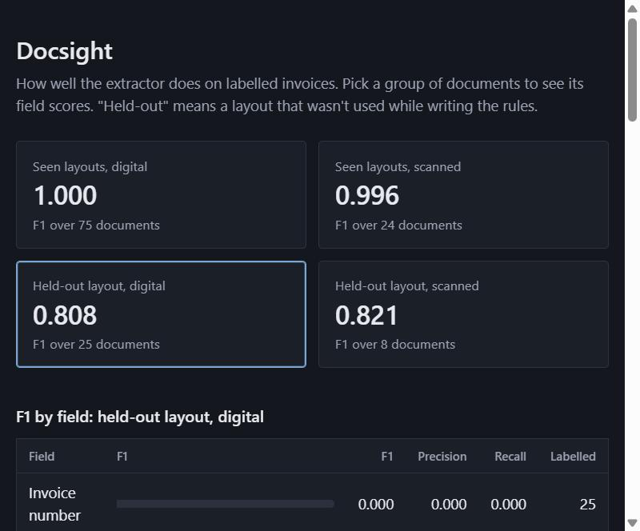

# Docsight

Reads invoices out of PDFs, digital or scanned, and returns structured fields. It also checks
whether the values make sense together, and tells you how much to trust it. The last part is
why I built this: extraction demos always look great on the sample they were built for, so I wanted
one that measures itself honestly.

Built with Python, FastAPI, pdfplumber, RapidOCR and spaCy.



## How it works

```
PDF -> text layer, or OCR if the page has none -> field extraction -> validation -> stored result
```

**Reading.** Each page uses its text layer if it has one, and OCR only if it doesn't, since OCR is
about 60 times slower here. OCR returns fragments in no useful order, so `group_into_lines`
rebuilds the lines from box positions.

**Extraction.** Mostly regular expressions around labels, because invoices are labelled and rules
are easy to debug. spaCy's NER is used for the one thing rules are bad at: finding the
company name in a letterhead when nothing labels it. Every field records how it was found, either
`label`, `ner` or `heuristic`.

**Validation.** Invoices contain their own checksums. Subtotal plus tax should equal the total, line
items should add up to the subtotal, and the due date shouldn't come before the issue date. Anything
that fails, or that was only guessed, goes to `needs_review`.

## Results

These come from `python -m app.evaluate`, and the raw reports are in `eval_results/`.

| Documents | Count | F1 | Every field right | Mistakes sent to review |
|---|---|---|---|---|
| Seen layouts, digital | 75 | 1.000 | 75 | no mistakes to catch |
| Seen layouts, scanned | 24 | 0.996 | 22 | 0 of 2 |
| Held-out layout, digital | 25 | 0.808 | 0 | 25 of 25 |
| Held-out layout, scanned | 8 | 0.821 | 0 | 8 of 8 |

How to read that:

- **The top two rows are flattering.** I wrote the rules while looking at those layouts.
- **The held-out rows are the real number.** Template D uses wording I deliberately didn't write
  rules for ("Document No.", "Goods value", "Your ref"). No document came through fully correct,
  but all of them went to review instead of being passed as fine. For this kind of system, that matters more
  than the F1.
- **All of this is synthetic data.** The invoices come from `samples/generate.py`, which degrades
  the scanned versions with blur, rotation and JPEG artifacts. Real invoices are messier, so expect
  lower scores on them.

### Known misses

I left the held-out failures unfixed, because fixing them would turn template D into another seen
layout and the score would stop meaning anything. To improve on it properly, I'd need a new
held-out layout each time.

- Invoice number and subtotal are blank on D, because their labels aren't in the rules.
- `Your ref PO69584` comes back as `69584`. The PO pattern treats the "PO" as a label and
  strips it from the value. This is a real bug.
- On two seen scans, OCR misses the € symbol, so currency comes back blank. Currency isn't
  a required field, so validation doesn't flag it. That's why the table shows 0 of 2.

## Running it

```
python -m venv .venv
.venv/Scripts/activate        # source .venv/bin/activate on Linux or Mac
pip install -r requirements-dev.txt

python samples/generate.py --out samples/data
python -m app.evaluate --data samples/data --note "what changed"
uvicorn app.main:app --reload
```

The dashboard is at http://localhost:8000, and API docs are at `/docs`. Or with Docker:

```
docker build -t docsight .
docker run -p 8000:8000 docsight
```

## API

| Method | Path | |
|---|---|---|
| POST | `/api/documents` | Upload a PDF, get the extraction back. The same file twice returns the same record. |
| GET | `/api/documents` | List results, optionally with `?status=needs_review` |
| GET | `/api/documents/{id}` | One result |
| GET | `/api/evaluations` | Past evaluation runs |
| GET | `/api/evaluations/{name}` | A full report, including every mistake |

## What I'd do next

- Test on real invoices. Public datasets exist, and they would tell me far more than my generator.
- Replace the label rules with a trained layout model once there's enough labelled data, keeping
  the validation layer as it is. I'd want this evaluation in place first to prove it's an improvement.
- Move OCR to a background job. A scan takes about 4 seconds and currently holds a request open.
- Add authentication. There is none right now, so don't expose this publicly.
